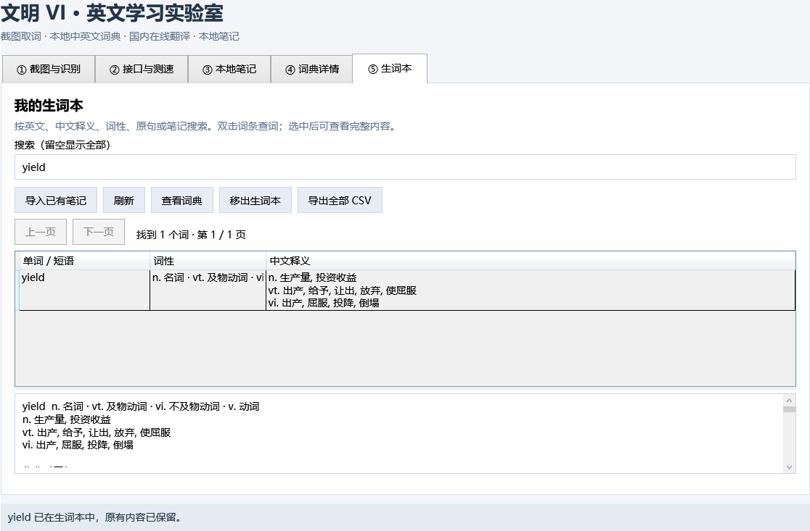

# 文明 VI 英文词典 · Civ6Dictionary

边玩《文明 VI》，边积累英语词汇。通过截图识别游戏文本，查询中英文释义、听发音，把游戏原句和自己的理解保存到可搜索的生词本。

**v0.4.1 · Windows x64 · C# / WPF / .NET 10**

本地查词、英文 OCR、朗读和笔记无需 API 密钥；整句翻译和联网补充可选用有道或百度接口。也适用于其他英文游戏和无法直接复制文字的阅读场景。



## 功能

| 功能 | 当前支持 |
| --- | --- |
| 截图取词 | `Ctrl+Alt+D` 框选屏幕，或打开本地图片；本地英文 OCR，支持放大与明暗预处理 |
| 单词与整句查询 | 点击识别出的单词填入查询栏，也可填入整段或选中的句子；支持手动修正文本 |
| 本地词典 | 约 77 万词条；音标、词性、多项中文释义、英文解释、词形变化及部分短语，支持部分词形还原 |
| 单词分节 | 使用本地 Moby 数据显示 `pro · duc · tion` 等书面分节，便于记忆 |
| 英文朗读 | 使用 Windows 英文语音朗读单词、原形、句子及英文解释，支持慢速与停止 |
| 原句与笔记 | 保存游戏原句和个人理解；双击查看长文本，支持修改、取消修改及 CSV 导出 |
| 可搜索生词本 | 收藏单词 / 短语；按英文、中文释义、词性、原句和笔记搜索；导入已有笔记、分页、移除及导出 |
| 在线翻译与测速 | 有道智云文本翻译（NMT）、百度通用翻译；显示耗时、成功率、中位数及 P95，可导出测试记录 |

生词本按规范化后的查询词去重，重复收藏保留原内容。每页最多显示 100 个词，搜索覆盖全部收藏。关联笔记修改后，刷新或重新选中词条即可查看最新内容。

## 快速开始

### 1. 准备环境

- Windows x64 桌面环境。本项目依赖 WPF、Win32 和 Windows 语音组件，不提供 macOS / Linux 版本。
- [.NET 10 SDK（Windows x64）](https://dotnet.microsoft.com/en-us/download/dotnet/10.0)：用于编译和运行源码。
- [Microsoft Visual C++ x64 运行库](https://learn.microsoft.com/en-us/cpp/windows/latest-supported-vc-redist)：供 Tesseract 原生库使用。
- 如需朗读，系统需有可供 Windows SAPI 使用的英文桌面语音。

**GitHub 仓库包含源码、词库和 OCR 模型，不包含本机的 `app/` 可运行目录、`tools/` SDK 或个人数据库。** 下载源码 ZIP 后也需要编译；不需要自行下载词典和英文 OCR 模型。

### 2. 下载并运行

在 PowerShell 中执行：

```powershell
git clone https://github.com/MingyuW488/Civ6Dictionary.git
cd Civ6Dictionary
powershell -NoProfile -ExecutionPolicy Bypass -File .\src\run.ps1
```

也可以下载源码 ZIP，完整解压后在项目根目录执行最后一条命令。首次编译需要访问 NuGet 恢复依赖；之后使用本地功能无需联网。脚本优先使用项目中的 `tools/dotnet` 和离线依赖源（若存在），否则使用系统安装的 `dotnet`。首次启动自动创建个人数据库。

### 3. 试一次完整流程

1. 打开“① 截图与识别”，点击“打开示例”，确认 OCR 能正常识别。
2. 在游戏窗口化 / 无边框模式下按 `Ctrl+Alt+D`，框选一段英文；Esc 或右键取消选区。
3. 点击识别出的单词，再点击“查词 / 翻译”或按 Enter，在“④ 词典详情”查看释义、分节和发音。
4. 翻译整句时，点击“整句 / 整段填入查询栏”；只翻译一部分则先选中文字，再点“选中文字填入”。填入本身不发起翻译请求。
5. 在截图页填写原句和个人笔记并保存；或在词典详情点击“☆ 收藏到生词本”。收藏会保存当前原句和笔记的快照。
6. 打开“⑤ 生词本”搜索；已有笔记可点击“导入已有笔记”合并导入。双击词条重新查词。

不配置翻译接口也能完成单词学习流程；整句翻译需要下面的接口配置。

## 在线翻译配置（可选）

在“② 接口与测速”选择服务商，填写同一个应用的 ID 和密钥。密钥只在当前进程使用，每次重启需重新填写。

| 服务商 | 需要开通的服务 | 第一项 | 第二项 | 官方文档 |
| --- | --- | --- | --- | --- |
| 有道智云 | 文本翻译（NMT） | 应用 ID，对应参数 `appKey` | 同一应用的应用密钥 | [有道文本翻译](https://ai.youdao.com/DOCSIRMA/html/trans/api/wbfy/index.html) |
| 百度翻译开放平台 | 通用翻译 | APP ID | 对应密钥 | [百度通用翻译](https://fanyi-api.baidu.com/doc/21) |

词典详情默认开启“联网补充翻译”：配置凭证后，先显示本地释义，再显示补充译文。关闭该选项后，单词 / 短语只查本地词典；完整句子仍使用在线翻译。在线失败不会清除已显示的本地释义。

程序通过 HTTPS 直接请求国内服务，禁用 HTTP 系统代理；系统级 VPN / TUN 仍可能影响路由。能否直连、访问速度、额度和费用取决于实际网络与服务账户。可用内置测速自行验证；每条测速都会真实调用接口，可能产生费用。

## 在 VS Code 中开发

打开根目录的 `Civ6EnglishDemo.code-workspace`，工作区会定位到 `src/`。

| 操作 | 入口 |
| --- | --- |
| 编译 | `Ctrl+Shift+B`，或“终端 → 运行任务 → 编译 DEMO” |
| 编译并运行 | “终端 → 运行任务 → 运行 DEMO” |
| 调试 | 安装工作区推荐的 Microsoft C# 扩展后按 F5 |

现有 F5 配置中的 `DOTNET_ROOT` 指向便携 SDK `tools/dotnet`。从 GitHub 克隆并使用系统 SDK 时，请删除 [launch.json](src/.vscode/launch.json) 中的这一环境变量项，或改成自己的 SDK 安装目录。编译和运行任务不依赖该扩展。

### 发布可直接运行的程序

在项目根目录执行：

```powershell
dotnet publish .\src\Civ6EnglishDemo.csproj -c Release -r win-x64 --self-contained true -o .\app
Copy-Item .\src\THIRD-PARTY-NOTICES.md, .\src\TESSERACT-WRAPPER-LICENSE.txt, .\src\LEPTONICA-LICENSE.txt -Destination .\app
Copy-Item .\src\tessdata\LICENSE -Destination .\app\tessdata
```

发布后双击根目录的“启动词典.cmd”，或运行 `app/Civ6EnglishDemo.exe`。自包含发布附带 .NET 运行时，目标电脑不必安装 .NET SDK；仍需满足前述原生运行库要求。请保留整个发布目录，包括 DLL、`data/` 词库及 `tessdata/` 模型。

## 技术栈与实现

| 层次 | 技术 / 组件 | 用途 |
| --- | --- | --- |
| 桌面界面 | C#、.NET 10、WPF / XAML | Windows 窗口、词典、笔记与生词本 |
| 截图与快捷键 | Win32 / GDI、全局热键 | 捕获屏幕像素与框选，不读写游戏进程 |
| 本地 OCR | Tesseract .NET 5.2.0、英文 LSTM 模型 | CPU 英文识别，按次创建和释放原生引擎 |
| 本地存储 | SQLite、Microsoft.Data.Sqlite.Core 10.0.0、SQLitePCLRaw.bundle_winsqlite3 2.1.11 | 使用 Windows 系统 SQLite，持久化笔记、收藏和测试元数据 |
| 词典与分节 | ECDICT、Moby Hyphenator II | 分别包含 770,611 条词条、167,763 条书面分节记录 |
| 离线语音 | Windows SAPI / COM | 独立 STA 线程播放，首次点击时加载 |
| 在线接口 | HttpClient、System.Text.Json | 有道 v3 签名 / 百度签名、超时、取消和响应解析 |
| 开发工具 | VS Code、.NET CLI、Git | 本地开发、构建和版本管理 |

词库按 SQLite 索引读取，不整体加载到内存；生词本列表按页展示，OCR 按需执行。实际内存占用随图片大小、识别状态和语音组件而变化，不承诺固定内存上限。

## 数据保存与备份

| 内容 | 位置 / 行为 |
| --- | --- |
| 个人笔记、生词本、测试记录 | 默认在项目根目录 `data/learning.db`，首次运行自动创建 |
| 只读词库与模型 | `src/data/`、`src/tessdata/`；构建时复制到程序输出目录 |
| 自定义数据位置 | 环境变量 `CIV6_DEMO_DATA`，优先于默认路径 |
| 单独分发程序 | 找不到祖先目录中的 `.civ6-project` 标记时，使用程序旁的 `user-data/` |
| API 密钥 | 不写入配置、数据库或测试日志 |
| 截图与在线译文 | 不自动持久化；翻译时仅将查询文本发往所选服务 |

例如在当前 PowerShell 会话中切换数据目录：

```powershell
$env:CIV6_DEMO_DATA = 'D:\MyCiv6Data'
powershell -NoProfile -ExecutionPolicy Bypass -File .\src\run.ps1
```

退出程序后复制整个个人数据目录即可备份；恢复时同样先退出程序。项目内普通启动与 VS Code 启动共用同一数据目录，请保留 `.civ6-project` 标记文件。

`data/`、`app/`、`tools/` 和构建缓存已加入 Git 忽略规则。克隆仓库不会带走个人学习记录；随仓库提交的两个 `.db` 是公开授权词库。笔记导出包含全部记录，生词本导出包含全部收藏快照，不受当前分页或搜索限制。关联笔记可从笔记页另行导出。

## 项目结构

```text
Civ6Dictionary/
├── README.md                       # 项目首页与使用指引
├── Civ6EnglishDemo.code-workspace   # VS Code 工作区
├── .civ6-project                    # 个人数据根目录标记
├── 启动词典.cmd                     # 发布到 app 后使用的启动入口
├── src/                            # WPF 源码、构建脚本和开发配置
│   ├── data/                       # 公开词库、分节表、来源与许可
│   ├── tessdata/                   # 英文 OCR 模型与许可
│   └── samples/                    # 不含游戏资产的 OCR 示例图
├── verification/                   # 已有验证记录与示例界面
├── app/                            # 本地生成：自包含发布程序（不入库）
├── data/                           # 自动创建：个人 SQLite 数据（不入库）
└── tools/                          # 可选：便携 SDK、依赖与缓存（不入库）
```

开发者可继续阅读 [开发与验证说明](src/README.md)。

## 常见问题与当前边界

**没有密钥，能不能用？** 可以使用本地查词、OCR、发音、笔记和生词本；整句翻译需要自行配置有道或百度。

**有道返回 108？** 检查是否填写了同一应用的一对“应用 ID + 应用密钥”。`appKey` 指应用 ID，不是服务实例 ID，也不要与密钥互换。

**截图黑屏或识别不准？** 先改用窗口化 / 无边框模式、缩小选区，并尝试明暗预处理。独占全屏、HDR、显卡覆盖层及多屏缩放可能影响结果；OCR 文本可以手动修正。

**朗读没有声音？** 检查输出设备、系统音量，以及是否安装兼容 Windows SAPI 的英文桌面语音。播放的是系统合成语音。

**快捷键无效？** 检查 `Ctrl+Alt+D` 是否被占用，或直接使用窗口中的截图按钮。Esc 可将主窗口最小化；关闭窗口退出程序。

**为什么有的词没有分节或释义？** 内容受本地数据覆盖范围影响。书面分节不等同于所有口音中的语音音节，也不标重音；缺失数据不会强行猜测。

**能自动复习或悬停取词吗？** 尚未实现间隔复习、鼠标悬停取词及跨设备同步。生词本支持英文单词和最多六词的短语，完整句子请保存在笔记中。生词本快照与关联笔记分别展示；“移出生词本”不会删除原笔记。

## 数据来源与第三方许可

- [ECDICT](https://github.com/skywind3000/ECDICT)：MIT；[随附许可](src/data/ECDICT-LICENSE.txt)与[固定版本、校验值及条数](src/data/dictionary-source.json)。
- [Moby Hyphenator II](https://www.gutenberg.org/ebooks/3204)：作者公开领域授权；[作者说明](src/data/MOBY-HYPHENATION-NOTICE.txt)与[来源记录](src/data/syllables-source.json)。
- Tesseract、英文模型、SQLite 适配组件及其他依赖的许可见 [第三方组件说明](src/THIRD-PARTY-NOTICES.md)。

本项目是独立的英语学习辅助工具；截图示例不包含《文明 VI》游戏资产。
